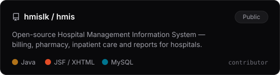

<picture>
  <source media="(prefers-color-scheme: dark)" srcset="./assets/banner-dark.svg">
  <source media="(prefers-color-scheme: light)" srcset="./assets/banner-light.svg">
  
</picture>

  

 

<h2 align="center">About</h2>

Hi, I'm **Shehara** — a software engineer from **Sri Lanka** 🇱🇰.

I build backend systems with **Java, PHP and MySQL**, and I spend a lot of my time **contributing to open source** — most of it on [**HMIS**](https://github.com/hmislk/hmis), an open-source Hospital Management Information System used by real hospitals.

By curiosity I'm an **ethical hacker**: I like to understand how systems break so I can build ones that don't.

I'm always trying out new ideas and building stuff from scratch.

 

<h2 align="center">Connect</h2>

  
  
  

<h2 align="center">Tech Stack</h2>

  
   
  

<h2 align="center">Open Source Contributions</h2>

  

  
  

<h2 align="center">Activity Graph</h2>

  

  ✦ Building in public — one commit at a time.

